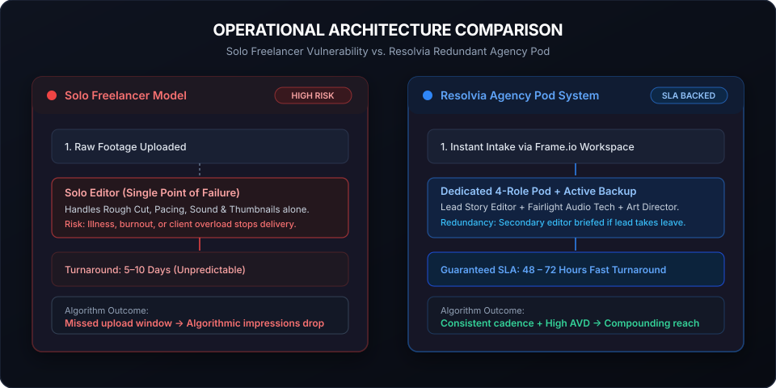
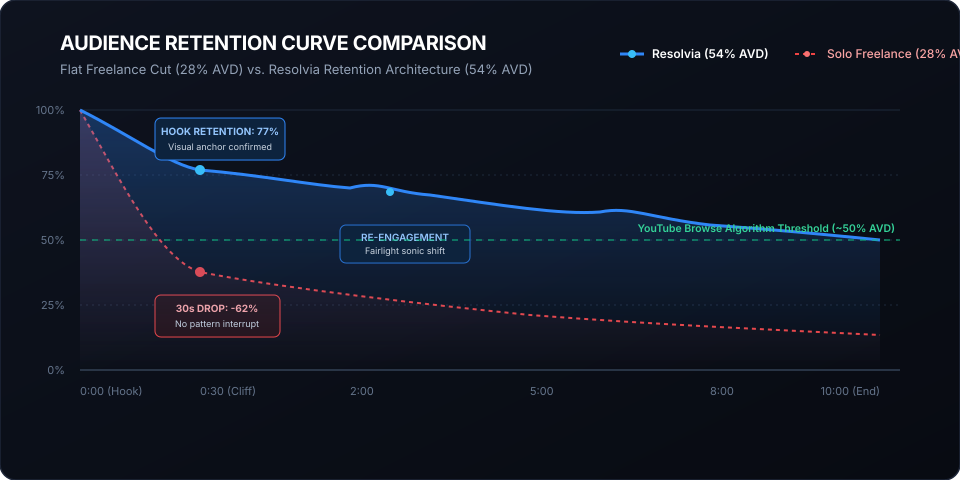

If you run an ambitious YouTube channel or a video-first brand, editing is your single largest operational bottleneck. 

As your channel scales past early traction, you inevitably face a critical fork in the road: **Should you hire a freelance video editor on Upwork, Twitter, or Discord, or should you partner with a dedicated video editing agency?**

While freelancers advertise low upfront per-project rates, they often introduce hidden management drag and erratic delivery schedules. On the other hand, agencies deliver institutional reliability and algorithm-tested retention systems, but require an established monthly budget.

Here is the objective, data-backed analysis to determine which solution fits your current channel stage, content cadence, and revenue model.

---

## 1. Direct Comparison Matrix: Agency vs. Freelance

| Evaluation Criteria | Solo Freelance Video Editor | Resolvia Studio Agency Pod |
| :--- | :--- | :--- |
| **Turnaround SLA** | 5 – 10 business days (high variance) | **Guaranteed 48 – 72 hours** |
| **Operational Redundancy** | Zero (illness or burnout halts uploads) | **Active secondary editor & backup team** |
| **Audio Engineering** | Basic volume balancing & stock music | **Fairlight broadcast DSP & custom foley** |
| **Retention Pacing** | Static cuts; limited audience analytics | **Algorithmic hook & pattern interrupt pacing** |
| **Visual Assets & B-Roll** | Often billed separately or limited | **Full enterprise asset licenses included** |
| **Packaging & Thumbnails** | Rarely included or amateur quality | **Dedicated CTR thumbnail artists included** |
| **Communication Channel** | Fragmented WhatsApp / Discord DMs | **Centralized Frame.io review workspace** |
| **Ideal Revenue Stage** | Under $3,000 / month | **$5,000 – $50,000+ / month** |

---

## 2. The Operational Architecture: Single Point of Failure vs. The Agency Pod

The fundamental difference between a freelancer and an agency is **operational resilience**.

### The Solo Freelancer Bottleneck
When you work with a solo freelancer, your entire post-production pipeline rests on a single human being. If that editor falls sick, takes a holiday, experiences a hardware crash, or takes on a higher-paying client, your channel's upload calendar stops cold. 

On YouTube, inconsistent uploads degrade viewer engagement and trigger algorithmic distribution penalties that can take months to recover from.

### The Resolvia Pod System
Professional agencies structure production around dedicated **creative pods**. When you partner with Resolvia, your channel is assigned:

1. **Lead Story Editor:** Crafts narrative rhythm, selects the strongest takes, and drives visual pacing.
2. **Fairlight Audio Engineer:** Cleans dialogue, removes room reverb, sculpts EQ curves, and weaves multi-stem sound design.
3. **Motion Graphics Specialist:** Builds custom kinetic typography, 3D callouts, and bespoke branding assets.
4. **Briefed Backup Editor:** Shadow-trained on your brand guidelines to step in seamlessly with zero downtime if your lead takes scheduled leave.

---

## 3. The Retention Curve: How Editing Strategy Dictates Algorithmic Reach

Many creators mistakenly treat video editing as simple footage trimming. In reality, modern YouTube editing is **attention engineering**.

YouTube's recommendation algorithm rewards one metric above all others: **Average View Duration (AVD)** and relative audience retention.

### The 30-Second Cliff
Raw data across thousands of creator videos reveals that standard freelance cuts lose **40% to 60% of viewers in the first 30 seconds**. When an editor simply cuts between pauses without visual anchors, curiosity gaps, or sensory sound design, casual clickers bounce immediately.

### Resolvia's 4-Beat Retention System
To sustain 50%+ AVD (the threshold required for YouTube to push videos into broad Browse and Suggested feeds), Resolvia implements a strict mathematical editing architecture:

- **0:00 – 0:03 (The Hook Anchor):** Immediate visual confirmation of the thumbnail promise with kinetic face tracking.
- **0:03 – 0:45 (The Premise Escalation):** Establishing the narrative stakes before introducing the first pattern interrupt.
- **Every 25–30 Seconds (Sensory Reset):** Strategic camera punch-ins, sonic whooshes, or B-roll switches that prevent cognitive habituation.
- **Fairlight Sonic Dynamics:** Dialing in loudness standards (-14 LUFS) with subtle bass risers and textural foley that re-engage wandering ears.

---

## 4. The True Total Cost of Ownership (TCO) Formula

Many founders and creators look only at the line-item invoice:
> *"A freelancer charges $350 per video, while an agency charges $2,500/month. The freelancer is obviously cheaper."*

This is an expensive mathematical illusion. To calculate the real cost of production, you must evaluate the **Total Cost of Ownership (TCO)**:

$$\text{True Cost} = \text{Contractor Invoice} + (\text{Creator Hours Spent Managing} \times \text{Hourly Value}) + \text{Software \& Asset Subscriptions} + \text{Cost of Delayed Uploads}$$

### Calculating Hidden Freelance Friction:
1. **Management Drag (8–15 Hours/Month):** Reviewing unpolished drafts, writing timestamped revision notes over Discord, downloading Google Drive files, and syncing audio stems. If your time as a founder or creator is worth \$150/hour, that represents **\$1,200 to \$2,250 in lost strategic time**.
2. **Software & Asset Licenses (\$200–\$400/Month):** Storyblocks/Envato subscriptions, Frame.io review seats, sound effect libraries, and thumbnail rendering tools.
3. **Thumbnail Redesigns (\$300–\$600/Month):** Paying a separate graphic designer for 2–3 thumbnail variants.

When all auxiliary costs are accounted for, an unmanaged freelance workflow frequently costs **more than an all-inclusive agency retainer**—while delivering significantly more stress and lower average retention.

---

## 5. When Does It Make Sense to Upgrade to an Agency?

You should transition from a solo freelancer to an agency partner when you recognize any of these three operational triggers:

1. **You Upload 4+ Videos Per Month:** Managing a solo freelancer's queue for weekly long-form videos plus accompanying Shorts creates constant logistical friction.
2. **Your Channel Earns Over \$5,000/Month:** Once sponsorships, digital products, or ad revenue exceed this threshold, your highest leverage activity is filming, ideation, and business growth—not reviewing video timelines.
3. **You Experience the "Plateau Effect":** Your subscriber growth has flattened despite excellent topics. This almost always indicates that your average retention is lagging behind category leaders due to pedestrian pacing.

---

## 6. The Verdict: How to Choose

### Choose a Freelance Video Editor If:
- You are in your first 6 months of creating content.
- Your monthly production budget is strictly below \$1,500.
- You publish infrequently (once a month or irregularly).
- You enjoy the hands-on process of directing individual cuts and sound choices.

### Choose Resolvia Studio Agency If:
- You treat your channel as a serious media enterprise or business acquisition engine.
- You require guaranteed **48 to 72-hour turnarounds** with predictable release schedules.
- You want an end-to-end post-production team: lead editor, audio mastering, kinetic graphics, and CTR-optimized thumbnails.
- You want to win the YouTube recommendation algorithm with proven 50%+ retention structures.

---

### Ready to Scale Your Post-Production?

Stop spending your weekends managing file transfers, fixing misaligned audio, and chasing ghosted freelancers. 

**[Book a 15-Minute Production Discovery Call with Resolvia Studio](https://calendly.com/resolviaai/meet)** to review your current retention curves, audit your channel's pacing, and deploy a dedicated editing pod for your channel.
